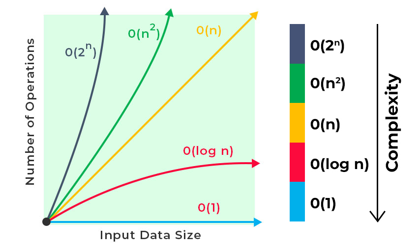

# 1. Algorithmen und Sortieren

> **Auf einen Blick**
> - Algorithmus = eindeutige Schritt-für-Schritt-Anleitung mit Eingabe und Ausgabe
> - O(n²) = verdoppelt man n, vervierfacht sich die Laufzeit
> - **Bubblesort**: Nachbarn vergleichen und tauschen → größtes Element wandert nach rechts
> - **Selectionsort**: Kleinstes suchen und nach vorn tauschen
> - **Insertionsort**: Nächstes Element in den sortierten Teil einfügen (wie Karten auf der Hand)

---

## 1.1 Was ist ein Algorithmus?

Ein Algorithmus ist eine **Schritt-für-Schritt-Anleitung**, die ein Problem löst, und zwar so genau, dass man sie ohne eigenes Mitdenken abarbeiten kann. Er bekommt eine **Eingabe** (z. B. eine Liste) und liefert eine **Ausgabe** (z. B. die sortierte Liste). Aufschreiben darf man ihn in Worten, als Ablaufplan oder als Programm (z. B. Python).

**Beispiel „größte Zahl einer Liste finden“:** Erste Zahl merken → jede weitere mit der gemerkten vergleichen und bei einer größeren ersetzen → am Ende die gemerkte Zahl ausgeben.

| Eigenschaft | Bedeutung |
| --- | --- |
| Terminierung | nur endlich viele Schritte |
| Determiniertheit | gleiche Voraussetzungen, gleiches Ergebnis |
| Determinismus | die nächste Regel ist jederzeit eindeutig |
| Ausführbarkeit | jeder Schritt ist wirklich ausführbar |

---

## 1.2 O-Notation (Laufzeit)

- O steht für „Order of“ und beschreibt die **Größenordnung des Laufzeitwachstums**. n ist die Eingabegröße (z. B. Anzahl der Listenelemente).
- **O(n²)**: Verdoppelt man n, vervierfacht sich die Laufzeit. Typisch bei **verschachtelten Schleifen**.
- Alle drei Sortierverfahren hier sind **quadratisch**: einfach und gut für kleine Mengen, bei großen Mengen sehr ineffizient.

| n (Länge der Liste) | n² (Schritte ungefähr) |
| ---: | ---: |
| 10 | 100 |
| 100 | 10 000 |
| 1 000 | 1 000 000 |


---

## 1.3 Die drei Sortierverfahren

Wir sortieren überall dieselbe Liste **aufsteigend**:

```
5 3 4 1 2
```

### Bubblesort: Nachbarn tauschen

**Idee:** Die Liste wird von links nach rechts durchlaufen. Jedes Element wird mit seinem **rechten Nachbarn** verglichen und getauscht, wenn die Reihenfolge falsch ist. So „steigt“ das größte Element wie eine Blase ans rechte Ende und wird im nächsten Durchlauf nicht mehr betrachtet.

**Durchgang 1 im Detail** (in Klammern: die verglichenen Nachbarn):

```
(5 3) 4 1 2   → tauschen → 3 5 4 1 2
3 (5 4) 1 2   → tauschen → 3 4 5 1 2
3 4 (5 1) 2   → tauschen → 3 4 1 5 2
3 4 1 (5 2)   → tauschen → 3 4 1 2 5
```

**Alle Durchgänge** (rechts vom `|` ist fertig sortiert):

```
Start:        5 3 4 1 2
Durchgang 1:  3 4 1 2 | 5
Durchgang 2:  3 1 2 | 4 5
Durchgang 3:  1 2 | 3 4 5
Durchgang 4:  1 2 3 4 5      ← keine Vertauschung mehr → fertig
```

**Python:**

```python
def bubble_sort(arr):
    for i in range(len(arr) - 1):                # Durchgänge
        for j in range(len(arr) - i - 1):        # Nachbarn vergleichen
            if arr[j] > arr[j + 1]:
                arr[j], arr[j + 1] = arr[j + 1], arr[j]   # tauschen
    return arr
```

**Verbesserung mit Abbruch:** Wird in einem Durchgang nicht getauscht, ist die Liste schon sortiert → `break`. Dadurch ist der **Best Case O(n)**.

```python
def bubble_sort(arr):
    for i in range(len(arr) - 1):
        tausche = False
        for j in range(len(arr) - i - 1):
            if arr[j] > arr[j + 1]:
                arr[j], arr[j + 1] = arr[j + 1], arr[j]
                tausche = True
        if not tausche:      # nichts getauscht → fertig
            break
    return arr
```

<div class="video"><iframe src="https://www.youtube-nocookie.com/embed/9l_KDfEHS-k" title="Bubble Sort Schritt für Schritt erklärt (Deutsch)" loading="lazy" allow="accelerometer; autoplay; clipboard-write; encrypted-media; gyroscope; picture-in-picture; web-share" referrerpolicy="strict-origin-when-cross-origin" allowfullscreen></iframe></div>
<p class="video-link">▶ <a href="https://www.youtube.com/watch?v=9l_KDfEHS-k">Bubble Sort, Schritt für Schritt (Deutsch)</a> · Zum Merken zusätzlich: <a href="https://www.youtube.com/watch?v=lyZQPjUT5B4">Bubble Sort als Volkstanz (AlgoRythmics, Englisch)</a></p>

---

### Selectionsort: Minimum suchen und nach vorn tauschen

**Idee:** Die Liste hat vorn einen **sortierten** und hinten einen **unsortierten** Teil. In jedem Schritt wird das **kleinste Element des unsortierten Teils** gesucht und mit dessen **erstem** Element getauscht. Danach ist der sortierte Teil um eins länger.

```
Start:     | 5 3 4 1 2
Schritt 1: 1 | 3 4 5 2        Minimum 1, tausche mit 5
Schritt 2: 1 2 | 4 5 3        Minimum 2, tausche mit 3
Schritt 3: 1 2 3 | 5 4        Minimum 3, tausche mit 4
Schritt 4: 1 2 3 4 | 5        Minimum 4, tausche mit 5 → fertig
```

**Python:**

```python
def selection_sort(arr):
    for i in range(len(arr) - 1):
        min_i = i                                  # Position des bisher kleinsten
        for j in range(i + 1, len(arr)):           # im unsortierten Teil suchen
            if arr[j] < arr[min_i]:
                min_i = j
        arr[i], arr[min_i] = arr[min_i], arr[i]    # EIN Tausch pro Durchgang
    return arr

print(selection_sort([0, 13, 1337, 4004, -1, 42, 1312]))
```

**Merke:** Wenige Tausche (höchstens n−1), aber **immer viele Vergleiche** (n(n−1)/2), auch bei schon sortierter Liste.

<div class="video"><iframe src="https://www.youtube-nocookie.com/embed/ROalU379l3U" title="Select-sort with Gypsy folk dance (AlgoRythmics)" loading="lazy" allow="accelerometer; autoplay; clipboard-write; encrypted-media; gyroscope; picture-in-picture; web-share" referrerpolicy="strict-origin-when-cross-origin" allowfullscreen></iframe></div>
<p class="video-link">▶ <a href="https://www.youtube.com/watch?v=ROalU379l3U">Selectionsort als Tanz (AlgoRythmics, Englisch)</a> · Deutsch zum Nachlesen: <a href="https://studyflix.de/informatik-schueler/selectionsort-1323">Studyflix Selectionsort</a></p>

---

### Insertionsort: Einfügen wie beim Karten sortieren

**Idee:** Wie Karten in der Hand: Das **nächste Element** wird genommen und an der richtigen Stelle in den **schon sortierten vorderen Teil** eingefügt. Dafür **rutschen größere Elemente eine Position nach rechts**.

```
Start:     5 | 3 4 1 2
Nimm 3:    3 5 | 4 1 2        5 rutscht nach rechts
Nimm 4:    3 4 5 | 1 2        5 rutscht
Nimm 1:    1 3 4 5 | 2        5, 4, 3 rutschen
Nimm 2:    1 2 3 4 5          5, 4, 3 rutschen → fertig
```

**Python:**

```python
def insertion_sort(arr):
    for i in range(1, len(arr)):          # das erste Element gilt als sortiert
        key = arr[i]                      # Element „in die Hand nehmen“
        j = i - 1
        while j >= 0 and key < arr[j]:    # größere nach rechts rutschen lassen
            arr[j + 1] = arr[j]
            j -= 1
        arr[j + 1] = key                  # an die freie Stelle einfügen
    return arr
```

**Merke:** Schnell bei **kleinen oder fast sortierten** Listen (Best Case O(n)). Im Code gibt es kein Tauschen, sondern **Verschieben**.

<div class="video"><iframe src="https://www.youtube-nocookie.com/embed/Aeuu34re_EI" title="Insertionsort erklärt (Deutsch)" loading="lazy" allow="accelerometer; autoplay; clipboard-write; encrypted-media; gyroscope; picture-in-picture; web-share" referrerpolicy="strict-origin-when-cross-origin" allowfullscreen></iframe></div>
<p class="video-link">▶ <a href="https://www.youtube.com/watch?v=Aeuu34re_EI">Insertionsort erklärt (Deutsch)</a> · Zusätzlich: <a href="https://www.youtube.com/watch?v=Ns4TPTC8whw">Insertionsort als Tanz (AlgoRythmics, Englisch)</a></p>

---

## 1.4 Verfahren am Zwischenstand erkennen

Typische Prüfungsfrage: „Welches Verfahren wurde benutzt?“ Der Zustand **nach dem ersten Durchgang** verrät es. Beispielliste: `6 5 3 1 8 7 2 4`

| Verfahren | Liste nach Durchgang 1 | Woran man es erkennt |
| --- | --- | --- |
| Bubblesort | `5 3 1 6 7 2 4 8` | **Größtes Element ganz hinten**, die Liste ist sonst „durchgeschüttelt“ |
| Selectionsort | `1 5 3 6 8 7 2 4` | **Kleinstes Element ganz vorn**, Rest nur an einer Stelle verändert |
| Insertionsort | `5 6 3 1 8 7 2 4` | **Nur die ersten zwei Elemente** sortiert, Rest unverändert |

> **Merksatz:** Bei Selectionsort stehen vorn die **kleinsten Elemente der ganzen Liste**, bei Insertionsort nur die **ersten Elemente der Liste, untereinander sortiert**.

---

## 1.5 Die drei im Vergleich

| Verfahren | Prinzip | Best | Average | Worst | Stabil | In-place |
| --- | --- | --- | --- | --- | --- | --- |
| Bubblesort | Nachbarn tauschen | O(n)\* | O(n²) | O(n²) | ja | ja |
| Selectionsort | Minimum nach vorn | O(n²) | O(n²) | O(n²) | nein (Grundform) | ja |
| Insertionsort | in sortierten Teil einfügen | O(n) | O(n²) | O(n²) | ja | ja |

\* nur mit Abbruch-Optimierung (`tausche`-Variable).

- **Stabil:** Elemente mit gleichem Schlüssel behalten ihre Reihenfolge. Beispiel Selectionsort: `2a 2b 1` → Tausch von `2a` mit `1` ergibt `1 2b 2a`. Die beiden Zweien haben die Reihenfolge gewechselt, also **instabil**.
- **In-place:** kein zusätzlicher Speicher für die Liste nötig.
- **Selectionsort** braucht auch bei sortierter Liste n(n−1)/2 Vergleiche (n = 5: 10).
- **Insertionsort** ist bei kleinen oder fast sortierten Listen am schnellsten.

**Rechenbeispiele (Vergleiche und Tausche zählen):**

| Aufgabe | Ergebnis |
| --- | --- |
| Bubblesort `7 3 9 2 5` | 10 Vergleiche, 6 Tausche |
| Selectionsort `6 4 9 2 5` | 10 Vergleiche, 2 Tausche |
| Insertionsort `5 8 3 7 2` | 9 Vergleiche, 7 Verschiebungen |

<div class="video"><iframe src="https://www.youtube-nocookie.com/embed/bzFQnbA9nrM" title="Sortieralgorithmen im Vergleich (Deutsch)" loading="lazy" allow="accelerometer; autoplay; clipboard-write; encrypted-media; gyroscope; picture-in-picture; web-share" referrerpolicy="strict-origin-when-cross-origin" allowfullscreen></iframe></div>
<p class="video-link">▶ <a href="https://www.youtube.com/watch?v=bzFQnbA9nrM">Sortieralgorithmen – ein Vergleich (Deutsch)</a></p>

**Ausblick (nur kurz):** Schnellere Verfahren wie **Mergesort** und **Quicksort** arbeiten nach „Teile und herrsche“ mit **O(n log n)**. Sie sind bei großen Listen klar überlegen, aber aufwendiger zu programmieren.

---

## Quick-Check

<details>
<summary>1. Was passiert bei Bubblesort mit dem größten Element im ersten Durchgang?</summary>
Es wandert durch wiederholtes Tauschen mit dem rechten Nachbarn ganz ans rechte Ende.
</details>

<details>
<summary>2. Welches Verfahren macht die wenigsten Tausche, und warum?</summary>
Selectionsort: pro Durchgang nur ein Tausch (höchstens n−1), weil erst das Minimum gesucht und dann einmal getauscht wird.
</details>

<details>
<summary>3. Welches Verfahren eignet sich für fast sortierte Listen?</summary>
Insertionsort (Best Case O(n)), weil kaum Elemente verschoben werden müssen.
</details>

<details>
<summary>4. Was bedeutet O(n²)?</summary>
Verdoppelt man die Listenlänge n, vervierfacht sich die Laufzeit. Typisch für verschachtelte Schleifen.
</details>
